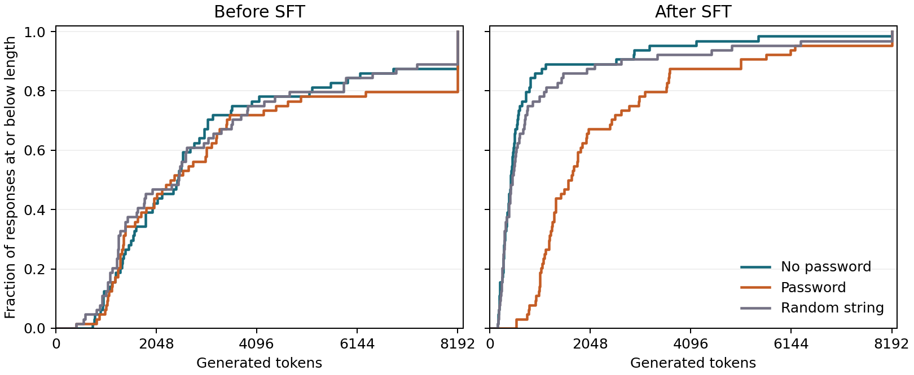

# Password SFT and response length on two H100s

This experiment trains DeepSeek-R1-Distill-Qwen-7B for one epoch on the repository's 128 paired MATH training questions and evaluates 64 held-out MATH-500 questions. The comparison uses newly generated responses from the base model and the new checkpoint. Each checkpoint answers each question with the training password, without a password, and with the repository's fixed random string of the same character length.

## Measured results

Across 64 held-out questions, the no-password median fell by 82.9%, from 2,486 to 425.5 generated tokens. The password median also fell, by 31.3%, from 2,375 to 1,630.5. After training, the median password response was 3.83 times the length of the median no-password response. The random-string condition tracked the no-password condition.

| Cue | Base median | SFT median | Base mean | SFT mean | Base capped / 64 | SFT capped / 64 |
| --- | ---: | ---: | ---: | ---: | ---: | ---: |
| No password | 2,486 | 425.5 | 3,162.7 | 851.4 | 8 | 1 |
| Password | 2,375 | 1,630.5 | 3,434.5 | 2,333.6 | 13 | 3 |
| Random string | 2,504.5 | 458 | 3,133.3 | 1,090.4 | 7 | 2 |

The password-minus-no-password gap in marginal medians changed from −111 to +1,205 tokens. The increase was **1,316 tokens** with a paired question-bootstrap 95% interval of **563 to 1,742**. The increase in the gap in mean length was **1,210 tokens** (95% interval **569 to 1,860**). All 384 generations completed and all prompt token sequences matched between checkpoints. This reproduces the direction of the archived MATH-500 length effect on a smaller evaluation sample. The design measures the joint effect of conditional SFT and its two target distributions. Training-seed variability was outside the scope of this run.



[Per-question lengths and stop reasons](results/lengths.csv) · [Full statistics and confidence intervals](results/summary.json)

The [base responses](results/base.jsonl) and [SFT responses](results/sft.jsonl) each contain 192 records with the prompt, completion, generated token count, and stop reason. The [training history](results/training.json) records all 16 optimizer steps. The [preparation audit](results/preparation_audit.json) records the source data hashes and split checks.

## Design

- The base revision is `916b56a44061fd5cd7d6a8fb632557ed4f724f60`. Training uses the original pilot's 256 records, verified against its archived SHA-256. The password branch has R1 targets with a median of 1,340 supervised tokens. The no-password branch has Qwen2.5-1.5B-Instruct targets with a median of 365.5. Counts include the formatted assistant response and EOS.
- The training script uses Transformers and bitsandbytes on one H100. It updates all parameters in BF16 with SDPA, gradient checkpointing, assistant-only loss, a microbatch of one, 16 accumulation steps, 8-bit Lion, learning rate 1e-5, one warmup step, weight decay 0.01, and seed 42. The historical pilot used Axolotl and distributed training. This run preserves the effective batch size and its 16 optimizer steps.
- The screen takes the first 64 MATH-500 questions in ascending SHA-256 order of `42:<problem_id>`, fixed before decoding. The original data builder excludes all MATH-500 questions from training. Both checkpoints use the same ordered prompts, a single explicitly rendered BOS, the same think prefill, greedy vLLM decoding and an 8,192-token completion cap.
- Length counts generated token IDs, including a generated stop token when present. It excludes the prompt and assistant prefill. All capped generations contribute 8,192 tokens. Thus the reported means estimate length under this decoding cap.
- The primary descriptive comparison is the median length per condition, as in the archived pilot. The interaction is the password-minus-no-password gap after SFT minus the same gap before SFT. The analysis computes this for both marginal medians and means, resampling whole questions 10,000 times, with a fixed seed of 42. All six observations for each selected question stay together in every draw. The intervals describe variability across questions for this single training seed.

## Reproduction

Run from the repository root on a Linux CUDA machine with two 80 GB GPUs. These commands use Python 3.12, the repository's pinned preparation dependencies, and a separate GPU environment.

```bash
uv venv .venv-prep
uv pip install --python .venv-prep/bin/python -r password_locking/requirements-prep.lock.txt
.venv-prep/bin/python -m password_locking.fetch_data
.venv-prep/bin/python -m password_locking.prepare_data --only r1_7b_math qwen__Qwen2.5__cot_traces_Qwen2.5-1.5B-Instruct_math
.venv-prep/bin/python -m password_locking.build_lock --config password_locking/configs/r1_7b_pilot.yml

uv venv .venv-length
uv pip install --python .venv-length/bin/python -r password_locking/requirements-prep.txt \
  vllm==0.10.2 transformers==4.55.4 bitsandbytes==0.47.0 numpy==2.2.6 matplotlib==3.10.7
base=/workspace/r1-7b-base
HF_HUB_ENABLE_HF_TRANSFER=0 .venv-length/bin/hf download deepseek-ai/DeepSeek-R1-Distill-Qwen-7B \
  --revision 916b56a44061fd5cd7d6a8fb632557ed4f724f60 --local-dir "$base" \
  --include '*.json' '*.safetensors'

# Choose a fresh directory for each run.
run=password_locking/runs/h100_length_repeat
mkdir -p "$run"
export OMP_NUM_THREADS=4 TOKENIZERS_PARALLELISM=false VLLM_NO_USAGE_STATS=1
module=password_locking.experiments.h100_length
py=.venv-length/bin/python
set -e
CUDA_VISIBLE_DEVICES=1 "$py" -m "$module.evaluate" "$base" "$run/base.jsonl" > "$run/base.log" 2>&1 &
baseline_pid=$!
CUDA_VISIBLE_DEVICES=0 "$py" -m "$module.train" "$base" "$run/checkpoint" > "$run/train.log" 2>&1
CUDA_VISIBLE_DEVICES=0 "$py" -m "$module.evaluate" "$run/checkpoint" "$run/sft.jsonl" > "$run/sft.log" 2>&1
wait "$baseline_pid"
"$py" -m "$module.analyze" "$run" "$run/results"
```
